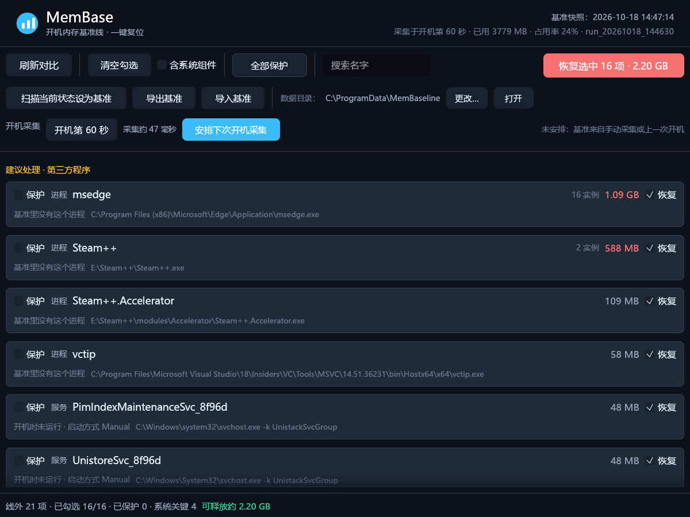
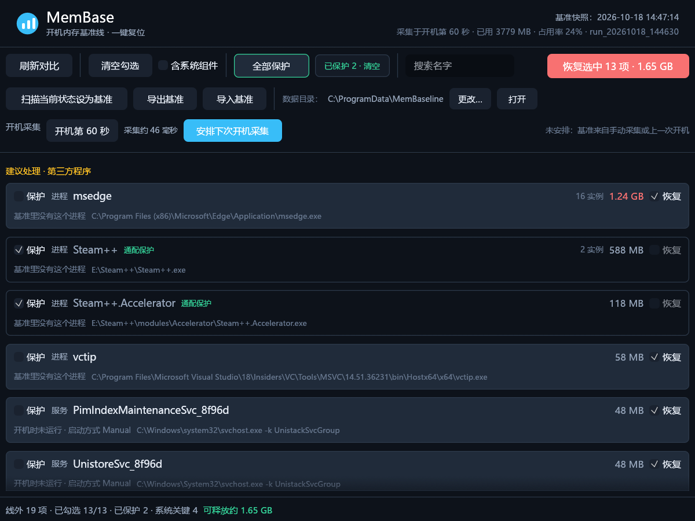

# MemBase

**开机内存基准线工具：在「刚开机」的那一刻拍一张进程与服务快照，之后随时对比、一键关掉基准之外的东西。**

Boot-time memory baseline for Windows: snapshot once at boot, diff against it any time, and trim whatever wasn't there.




---

## 它解决什么问题

排查「开机越来越慢 / 内存莫名被吃」时，最缺的是一个**可信的参照物**：

- 任务管理器只有当下，看不到「刚开机时是什么样」
- 想复现冷启动就得重启，一天重启八次不现实
- 网上说的「占内存大户」跟你机器上的真实情况往往不是一回事

MemBase 把「开机第 N 秒」那一刻的进程与服务完整记成**基准线**，之后任何时候拍一张实时快照做 diff —— 不用重启，也不会被「我刚开了一堆东西」干扰判断。

## 三个核心概念

| 概念 | 说明 |
|---|---|
| **基准线（baseline）** | 一份快照目录：`system.json` + 进程表 + 服务表 + 可读报告 |
| **线外清单（plan）** | 相对基准线多出来的进程/服务，分三档：建议 / 谨慎 / 禁止 |
| **恢复基准（trim）** | 关掉线外项。**默认 dry-run**，必须显式 `--execute` 才动手；动手时**先礼后兵** |

## 快速开始

需要 Windows 10/11 + Rust 1.75 以上，或直接用 Release 里的 exe。

```powershell
# 1) 构建
cargo build --workspace --release
#   target\release\membase.exe      命令行版
#   target\release\membase-ui.exe   界面版

# 2) 挂一次开机采集任务（SYSTEM 权限、无窗口），采完自动销毁任务和程序副本
membase.exe install --at 60

# 3) 之后不用等到下次开机也能对比
membase.exe compare                 # 与基准线做 diff
membase.exe list                    # 列出线外项（只读）
membase.exe trim --execute --yes    # 关掉线外项，回到基线状态（先礼后兵，见下）

# 4) 不想等到下次开机？直接拿当前状态当基准
membase.exe baseline capture
```

采集的两种方式等价，用哪个都行：

- **界面**：第三行「开机采集」→ 拖动秒数 → 点「安排下次开机采集」（需要管理员权限）
- **命令行**：`membase install --at 60` / `membase uninstall`

> 计划任务由 `crates/win/src/task.rs` 生成并注册：SYSTEM 账户、开机触发、20 分钟上限、
> 电池下也执行、错过则补跑；采完写快照，然后删任务、删程序副本，不留常驻进程。

## 界面

左侧导航分五页，顶部是全局搜索，底部是实时统计：

```
进程        线外清单表格（名称 / 类型 / 分级 / 内存 / 保护 / 恢复），内存列按用量热力着色
基准        基准快照时间 · 采集于开机第 N 秒 · 已用内存 · 占用率 · 数据来源目录 · 导出/导入
保护名单    protect.txt 的全部规则，可整份清空
开机采集    开机第 N 秒 · 采集耗时 · 计划任务状态 · 安排/取消
设置        数据目录 · 运行身份 · 外观（浅色/深色）· 三档分级与先礼后兵的说明
```

「进程」页顶部的按钮：刷新对比 · 含系统组件（全选范围开关）· 全部保护 / 取消全部保护 ·
全选 N 项 / 清空勾选 · 恢复选中 N 项（主操作，蓝色实心）。

**每行两个勾选框，含义不同：**

| 位置 | 名字 | 作用 | 是否写盘 |
|---|---|---|---|
| 每行右侧 | 「恢复」 | 这一轮要关掉它 | 否，刷新后按默认值重置 |
| 每行左侧 | 「保护」 | 永不处理，写进保护名单 | 是，立即生效 |

**批量操作只有两个按钮，文字写的是「点下去会发生什么」，不是当前状态：**

| 控件 | 三种形态 | 点下去 |
|---|---|---|
| 勾选按钮 | `全选 16 项` / `清空勾选` / `无可勾选项` | 在全选与一个不选之间翻转 |
| 保护按钮 | `全部保护` / `取消全部保护` | 整份名单一次写入或一次撤掉 |
| `已保护 N · 清空` | 只有「保护了一部分」时出现 | 把这 N 项从名单里去掉（通配规则保留） |

同一个按钮会自己变成反操作，所以没有「全部保护 / 取消保护」来回点的循环。中间的「含系统组件」只是**全选的范围开关**（放开「谨慎处理」那一栏），不参与保护。

「采集约 N 毫秒」同样是实测值：来自基准 `system.json` 里的 `CollectMs`（枚举进程与服务的用时，不含写盘）；老基准没有该字段时，用本次刷新的实测值兜底。这个数字通常是几十毫秒，所以「开机第 60 秒采集」对开机体验没有可感知的影响。

## 命令行

每个原子操作一个动词：

| 命令 | 作用 |
|---|---|
| `status` | 基准线信息 + 当前内存 + 线外计数 |
| `list` | 列出线外进程/服务（`--all` 含关键项） |
| `plan` | 只生成计划，可 `--to` 写 CSV |
| `trim` | 恢复基准：`--execute` 才动手，`--max` 限制数量，`--grace-wait` / `--force` / `--no-force` 控制关闭方式 |
| `kill <名\|PID>` | 原子操作：终止指定进程，同样走先礼后兵（`--grace-wait` / `--force` / `--no-force`） |
| `svc stop\|start <服务>` | 原子操作：启停单个服务 |
| `protect list\|add\|remove\|clear` | 保护名单，支持 `MuMu*` 通配 |
| `collect` | 采集快照（`--at` 指定开机后第几秒） |
| `compare` | 与最近一次基准 diff |
| `baseline info\|verify\|capture\|export\|import` | 基准线本体：查看 / 校验 / 采集当前态 / 打包 / 还原 |
| `config get\|set\|clear` | 数据目录 |
| `commands` | 自描述：所有命令 + 参数 + 平台 + 退出码表 |
| `install` / `uninstall` | 开机计划任务 |

所有命令都支持 `--json`，输出是**纯 ASCII 转义**的 JSON（中文走 `\uXXXX`），任何代码页下都不会解析失败，适合脚本与 AI 调用：

```powershell
membase list --json | ConvertFrom-Json
membase trim --execute --yes --max 5 --json
```

退出码固定：`0` 成功 / `1` 参数 / `2` 无基准 / `3` IO / `4` 动作失败 / `5` 被护栏拒绝。

## 数据目录

优先级从高到低：

```
--out DIR  >  MEMBASE_ROOT  >  %APPDATA%\MemBase\config.json  >  %ProgramData%\MemBaseline
```

配置放 APPDATA 而不是数据目录里 —— 数据目录本身可能被改，配置得先找得到。界面第二行直接显示当前目录，`[更改…]` 可以换到任意位置。

目录里只有四类内容，不会有脚本或一次性产物：

```
<数据目录>\
├─ membase.exe                      install 自动拷贝的命令行副本（开机任务执行它）
├─ protect.txt                      保护名单
├─ run_YYYYMMDD_HHMMSS\<标签>\      快照：system.json / processes.csv / services.csv / summary.md …
└─ exports\baseline_<时间>.mbz      基准包
```

## 保护名单（protect.txt）

纯文本，就放在数据目录里。界面的勾选框和 `membase protect add` 写的是**同一个文件**，改完不用重启，下次刷新即生效：

```
# MemBase 保护名单（每行一项，格式 进程:名字 或 服务:名字）
进程:MuMu*
服务:DPS
```

- 每行一条，`#` 开头是注释，空行忽略；保存时按字母排序重写，注释头保留
- 三种写法：`进程:chrome`（精确）、`进程:MuMu*`（同类型通配，`*` `?`）、`MuMu*`（裸名，进程与服务都匹配）
- 只对同一类型生效：`进程:DPS` 不会顺手保护同名服务；匹配不区分大小写
- 界面里「已保护」= 精确命中，「通配保护」= 被通配规则命中，悬停能看到命中的是哪一条
- 保护优先于「恢复」勾选：被保护的行勾选框置灰，统计与执行都会跳过
- 保存只重写「当前列表覆盖到的条目」，通配规则、此刻没在跑的旧项不会被顺手抹掉



## 基准包（.mbz）

`baseline export` 把 `run_<时间戳>\<标签>\` 里的快照打成一个 zip（后缀 `.mbz`），单文件就能拷走、归档、拿到别的机器上复盘：

```powershell
membase baseline export                        # → exports\baseline_<采集时间>.mbz
membase baseline export --to D:\bk\boot.mbz    # 自己指定路径
membase baseline import D:\bk\boot.mbz --label imported --force
```

- 包内 6 个文件：`manifest.json`（generator / format / captured_at / uptime_sec / files / crc32）+ `system.json` + `processes.csv` + `processes_by_name.csv` + `services.csv` + `summary.md`
- `import` 先校验文件清单与 crc32，坏包不落地；解开成 `run_<采集时间>_import\` 并成为最新基准
- 包是 store 方式的 zip（不压缩），只保证与自身互操作

## 关闭是怎么发生的（先礼后兵）

`trim --execute` 和界面「恢复选中」都不是上来就砍，顺序固定：

1. **身份复核** —— 用 `(PID, 创建时间)` 重新打开每个目标；PID 已被系统回收复用就跳过，
   不会打在刚启动的新进程上；
2. **有可见窗口的** 发 `WM_CLOSE` —— 和你点标题栏那个 ✕ 是同一条消息，程序可以弹「是否保存」；
3. **没有窗口的**（后台常驻、更新器）没有 UI 可等，直接终止；
4. **宽限期**（默认 3 秒）到点还没退的，才在身份校验下强杀；
5. 结果分类上报：`礼貌关闭 / 强制 / 已退出 / 跳过 / 仍未退出`，不再只报一个「成功」。

| 用法 | 行为 |
|---|---|
| 默认 | WM_CLOSE → 等 3 秒 → 强杀 |
| `--grace-wait 10` | 多给点时间（正在编译、正在写文档） |
| `--no-force` | 只礼不兵：关不掉就留着，报告里写「仍未退出」 |
| `--force` | 跳过 WM_CLOSE 直接终止（旧行为，脚本想快就用它） |

界面和命令行共用 `crates/win/src/close.rs` 这一份编排；多组一起关时**共用一个宽限期**，
不是每组各等 3 秒（20 项也不会卡一分钟）。

## 安全模型

这是个会终止进程的工具，所以护栏比功能重要：

1. **三档分级** —— 建议（第三方程序）/ 谨慎（Windows 组件，需显式勾选）/ 禁止（csrss、lsass、svchost、dwm、MsMpEng 等，永不触碰）
2. **自身保护** —— 不杀自己、启动自己的进程树，以及所有 `membase` 实例
3. **身份而不是 PID** —— 目标以 `(PID, 创建时间)` 记录，动手前在同一句柄上复核，
   PID 被复用、进程已退出都会让这一项被跳过而不是误伤
4. **执行前二次校验** —— 即使计划文件被改写，关键组件依然拒绝执行
5. **默认 dry-run** —— 不加 `--execute` 只出计划；非交互环境必须显式 `--yes`；超过 `--max`（默认 20）直接拒绝
6. **先礼后兵** —— 有窗口的先 `WM_CLOSE`（等同点 ✕），宽限期后才强杀；无窗口进程才直接终止
7. **服务不级联** —— 只用 `Stop-Service`（无 `-Force`），有依赖在跑就报错跳过

> 杀进程只做「对照实验」用。真正省内存的做法是排查出元凶后卸载它、或禁掉它的自启项；被系统判定为必需的东西杀了也会自己回来。

## 架构

按「纯逻辑 / 平台 / 前端」分层，两个前端共用同一套判定：

```
.
├── crates/core/   membase-core   分级、CSV、diff、线外计划、基准打包、配置
│                                 零平台依赖、零 unsafe，可在 Linux/容器里跑测试
├── crates/win/    membase-win    Win32 FFI：进程 / 服务 / 快照 / 计划任务 / 关闭编排
│                                 整个工程唯一允许 unsafe 的地方
├── apps/cli/      membase-cli    → membase.exe（命令行）
└── apps/gui/      membase-gui    → membase-ui.exe（egui）
```

`unsafe_code` 在 workspace 级别 `forbid`，只有 `membase-win` 单独放开。界面与命令行都调用 `core::build_plan()`，判定规则只有一份；开机任务的定义也只有 `win::task` 一份，界面按钮与 `install` / `uninstall` 共用。

## 构建与测试

```powershell
cargo build --workspace --release   # 完整构建（CLI + 界面）
cargo test --workspace              # 全部测试（CI 在 Windows 上跑的也是这条）
```

测试标准（分层原则、判定门槛、CI 闸门、发版前人工验收清单、哪些东西**不**测）见
[docs/TESTING.md](docs/TESTING.md)。

## 已知限制

- **按进程名归组**：同一程序的多开实例算一项，恢复时整组处理；
  实例身份按 `(PID, 创建时间)` 记录，能防 PID 复用误伤，但不区分「哪几个实例是线外的」
- **无窗口进程没有「礼貌」一说**：只对有可见窗口的进程发 `WM_CLOSE`；
  控制台脚本（`python train.py`）也算无窗口，会被直接终止 —— 勾选前看清楚
- **窗口判定偏保守**：只看「可见 + 有标题的顶层窗口」，托盘程序和部分 UWP 子窗口会被当成无窗口进程
- `CommandLine` 仍为空（要读目标进程的 PEB，跨位数/受保护进程还会失败）；
  `Manufacturer` / `Model` / `PhysicalProcessors` / 页面文件三项仍为 `null`（需要 WMI 或性能计数器）
- `PagedSystemMB` 是进程的分页池配额（`QuotaPagedPoolUsage`），`VirtualMB` 是提交大小
  （`PagefileUsage`），都不等于「虚拟地址空间」；`CpuSeconds` 是进程启动至今的累计 CPU 时间，
  不是「开机后用了多少」
- 打不开令牌 / 句柄的进程（受保护进程、跨会话的高权限进程）`UserName`、`CpuSeconds`、
  内存三项会是空值或 0，不是采集出错
- GUI 仅 Windows；CLI 的采集与清理能力也仅 Windows（`baseline` / `config` / `commands` 跨平台）

## 变更记录

当前 **0.5.1**：修复 `--self-destruct` 残留程序副本；补齐快照里的 `UserName` / `CpuSeconds` /
`PagedSystemMB` / `VirtualMB` / `OsCaption` / `OsVersion` / `OsBuild`。
上一版 **0.5.0**：先礼后兵（`WM_CLOSE` → 宽限期 → 强杀）、`(PID, 创建时间)` 实例身份、CI。
完整历史与格式 / 接口变化见 [docs/CHANGELOG.md](docs/CHANGELOG.md)。

## License

MIT
