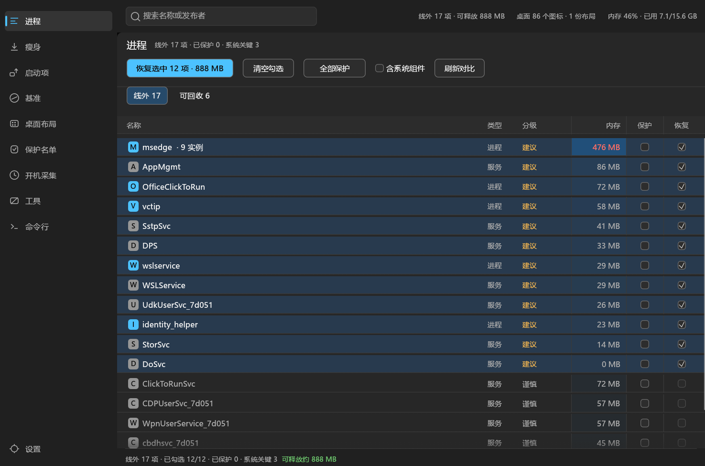
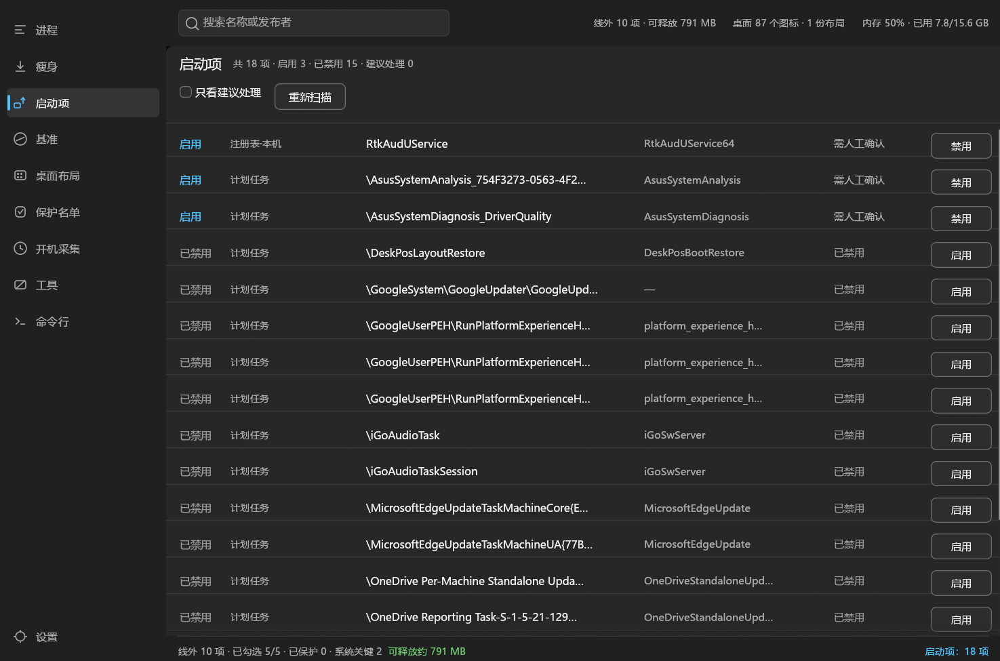
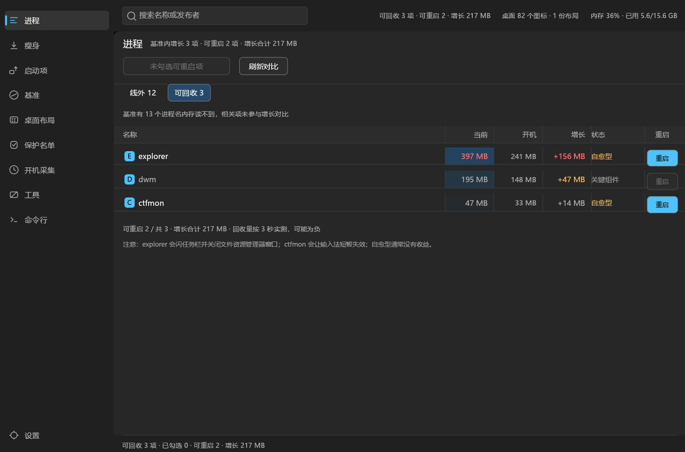
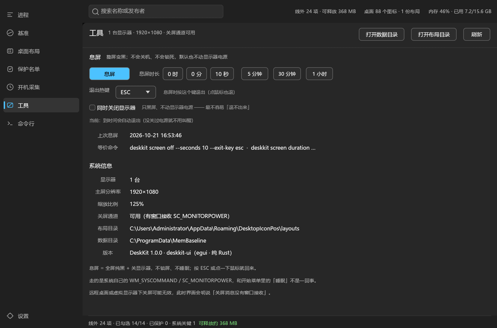
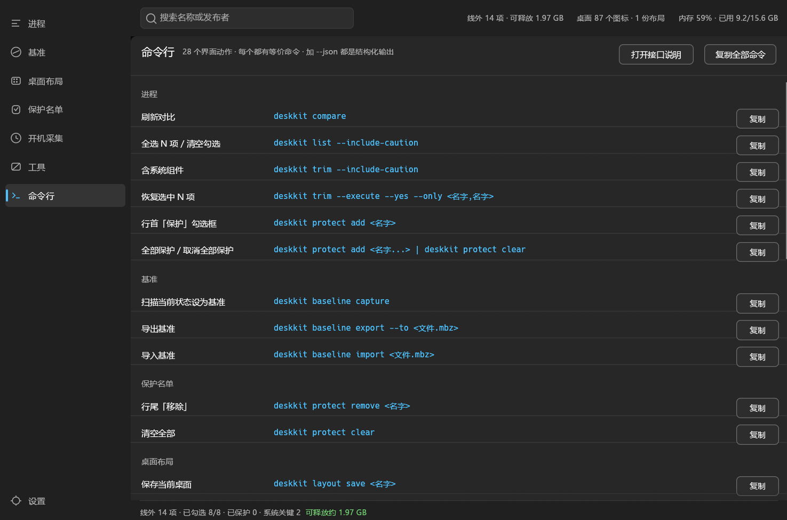
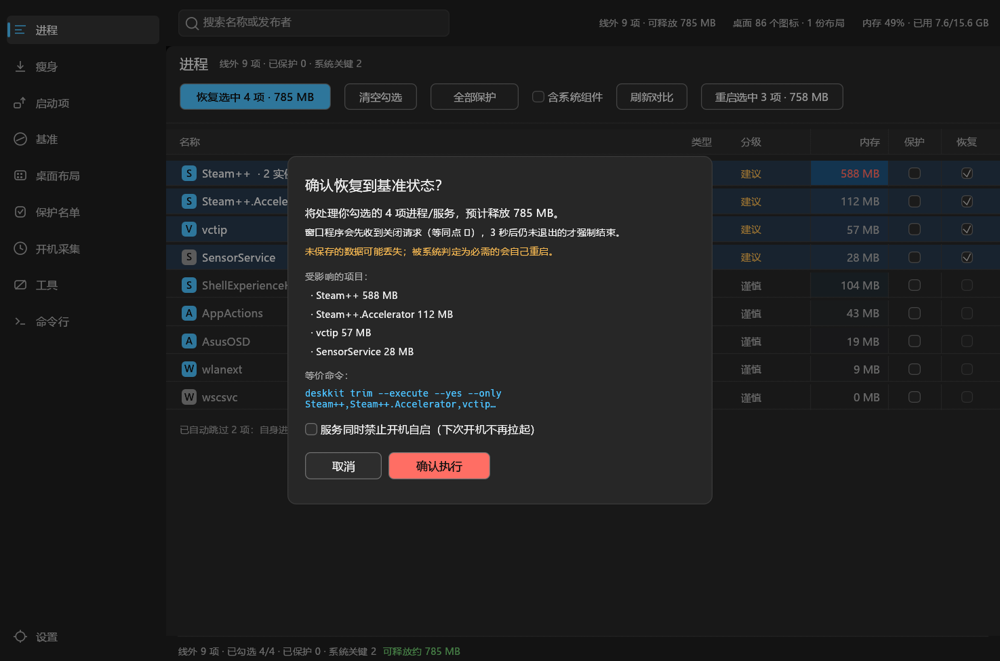

# MemBase

**开机内存基准线 + 桌面图标布局，一个纯 Rust 程序。**

Windows 开机久了，内存被谁吃了、桌面图标被谁弄乱了？MemBase 把这两件事放进同一个窗口：
左侧切页，右侧查看和处理。界面用 egui 绘制，没有 .NET / Python / 浏览器运行时依赖。

桌面布局页的预览就是桌面的真实样子：真壁纸、真图标、真任务栏。



## 功能

| 功能 | 说明 |
|---|---|
| 开机内存基准线 | 开机第 N 秒由 SYSTEM 计划任务采集快照；之后随时对比，列出基准之外的进程与服务 |
| 基线瘦身 | 以基准为输入，找出「开机就有、但根本不需要」的服务 / 启动项 / 功能开关：禁用自启 / 卸载 Store 应用 / 停进程并禁用启动项 / 关功能开关，下次开机生效 |
| 局部重启 | 关掉再按原路径拉起，等 3 秒**实测**回收了多少；自愈型进程（杀了就回来）会明确标出来，不冒充收益 |
| 启动项扫描 | Run（用户/本机/32 位）、启动文件夹、计划任务（含 `\Microsoft\` 下的系统任务）；**还没跑起来就先看见**，禁用可逆 |
| 桌面图标布局 | 保存 / 对比 / 恢复图标位置，带真实预览、差异条和当前位置叠加 |
| 息屏 | 全屏纯黑，ESC / 空格 / 回车 / 任意键退出；时长精确到秒；默认不动显示器电源 |

## 瘦身：让开机基线本身变小

`trim` 关的是「基准里没有、现在却在跑」的线外项，当场见效；
`slim` 关的是「基准里就有、但开机不需要」的服务 / Store 应用 / 功能开关，**改的是下一次开机的起点**。两者方向相反，别混。

界面上这两件事分在两页：「进程」页管线外项与局部重启，「瘦身」页管基准内部的裁减。

同一台 16 GB 机器，开机第 30 秒实测：

| | 瘦身前 | 瘦身后 |
|---|---:|---:|
| 已用物理内存 | 3710 MB | **3449 MB** |
| 进程工作集合计 | 3011 MB | 2748 MB |
| 进程 / 线程 | 100 / 1830 | 92 / 1640 |
| 运行中服务 | 86 | 82 |

一条 `slim --execute --yes` 卸掉 Store 版电脑管家（141 MB）、禁用 Office 与模拟器的自启服务（66 MB），
另有运行中被连带清掉的崩溃上报进程。

- 动作只有三种：`disable-service`（改服务启动类型）、`uninstall-appx`
  （路径落在 `\WindowsApps\` 下的按包名卸载——只禁服务会被重新挂起来）、
  `feature-off`（关一个已知功能开关，只写 HKCU）
- 默认只给第三方与 Store 应用；`--include-caution` 才带上 Windows 目录下的组件，
  那里面 `iphlpsvc` / `IKEEXT` / `nsi` 禁了会断网，必须逐条判断
- 合计按宿主 PID 去重：同一个 svchost 上挂 10 个服务只有一份内存，相加是假账
- 基准是历史快照，已禁用/已卸载的项会自动跳过，重复执行不会反复建议同一批
- 功能开关只收录「想清楚了」的项，每项都带证据进程（按父进程链归属，不把 Edge 的
  webview2 算成搜索的）和撤销写法，不开放任意注册表编辑

## 局部重启：拿回进程工作集，不重启整机

整机重启不可替代的只有内核池碎片、句柄泄漏、驱动累积状态；可回收量的大头在进程工作集。

```bash
MemBase.exe restart explorer                    # 演练：报实例数、内存、可执行路径
MemBase.exe restart explorer --execute --yes    # 真做：关掉 → 拉起 → 等 3 秒实测
```

- 关闭复用 `trim` 的同一套「先礼后兵 + 身份校验（PID + 创建时间）」，不另写一份
- 只动有明确 `Path` 的进程；`svchost` / `dllhost` / `WmiPrvSE` / `RuntimeBroker` 是共享宿主，
  拒绝走进程重启，改走服务（`stop` + `start`，标注「共享宿主，变化不全是这个服务」）
- `explorer` / `SearchHost` 会闪任务栏、关掉已打开的窗口，必须显式 `--yes`
- 报的是**实测值**：2026-10-21 真机实测 `Notepad` 162.6 → 163.2 MB（负收益照实报）、
  `SearchHost` 147.0 → 156.6 MB 且 2 秒内自愈（标 `revived`，不重复拉起）

自愈型进程（外壳托管的 `SearchHost`、`explorer` 之类）杀掉会被系统重建，对它们做重启没有收益 —
工具会把这种情况标出来，而不是把「关掉又回来」算成省了内存。

## 启动项：还没跑起来就先看见

进程要等它跑起来才看得见，启动项**还没跑**就已经写在系统里了。MuMu 三件套、`crashpad_handler` 这类东西，
等它们出现在快照里就晚了。



```bash
MemBase.exe startup list                      # 来源 / 名称 / 目标进程 / 是否在基准里 / 建议动作
MemBase.exe startup list --all                # 连 `\Microsoft\` 下的系统计划任务一起列
MemBase.exe startup disable RtkAudUService --execute --yes
MemBase.exe startup enable  RtkAudUService --execute --yes
```

- 三路来源：注册表 `Run`（HKCU / HKLM / 32 位视图）、启动文件夹、计划任务
- `\Microsoft\` 下的系统任务照收但打 `system` 标记，默认不展开 —— VS 安装器的
  `\Microsoft\VisualStudio\Updates\BackgroundDownload` 就在里面，实测开机 300 秒时占 339 MB
- `.lnk` 的目标用 shell 自己的 `IShellLinkW` 解，不猜二进制
- 命令解析覆盖引号路径、无引号带空格、`rundll32 <dll>,<entry>`、`%ProgramFiles%` 展开，
  以及 `by user disabled` 这种占位串（Google Updater 会把任务的 Command 改写成这句话）
- **禁用不删原值**：Run 与启动文件夹走 `Explorer\StartupApproved\...` 的批准记录（任务管理器那个开关），
  计划任务走 `schtasks /change /disable`，都能一条命令恢复
- 每条标注「基准里出现过没有」，把「装了但没常驻」和「真常驻」分开

## 双采样：分清「短命项」和「真常驻」

单点采集分不清「起了又退」和「一直挂着」：C 里 `TabTip` 没起、A 里它占了 77 MB，就是典型噪音。

```bash
MemBase.exe install --at 30 --also 300     # 一次开机采两点，同一个 run_* 目录下
MemBase.exe transient                      # 先出现、后消失的项单独成组
MemBase.exe compare --label T+300s         # 用第二个采样点当基准
MemBase.exe status                         # 会列出这次开机的所有采样点
```

- 两条命令都写在一个 `run_<时间戳>\` 下：`T+30s\` 与 `T+300s\`，采集仍是同一个计划任务、采完自毁
- `transient` 判据是「早的那份有、晚的那份没有」，收益计算时要先扣掉这批

## 界面

左侧导航十页：

| 页面 | 内容 |
|---|---|
| 进程 | 两个标签：「线外」= 基准里没有、现在在跑的项（名称 / 类型 / 分级 / 内存 / 保护 / 恢复）；「可回收」= 基准内、跑久了的增长项（当前 / 开机 / 增长 / 状态），行尾「重启」点一下就重启这一项，点行勾选可批量 |
| 瘦身 | 基准内部可砍的服务 / Store 应用 / 功能开关，勾选后确认执行；弹窗写明**下次开机**才反映到基准 |
| 启动项 | Run / 启动文件夹 / 计划任务，行尾直接「禁用 / 启用」，悬停看完整命令行 |
| 基准 | 快照时间、采集于开机第 N 秒、已用内存，导出 / 导入 `.mbz` |
| 桌面布局 | 布局清单、真实预览、差异条、保存 / 恢复 / 删除 / 修复缓存 |
| 保护名单 | `protect.txt` 的全部规则，可单条移除或整份清空 |
| 开机采集 | 开机第 N 秒采集，可勾「双采样」再采一次；SYSTEM 权限、无窗口，采完自动销毁任务 |
| 工具 | 息屏（可配热键和时长）+ 显示器与路径信息 |
| 命令行 | 38 个界面动作与等价命令，逐条可复制 |
| 设置 | 数据目录、布局目录、运行身份、浅色 / 深色外观 |

### 进程页的两个标签

「线外」处理基准里没有、现在在跑的项；「可回收」只列基准内跑久了的增长项，按「当前 − 开机」排序。行尾那个「重启」按钮点一下就走一次实测重启（关掉 → 按原路径拉起 → 等 3 秒量回收量），不用先勾选；点行是勾选，勾完可用顶栏批量重启。重启跑在后台线程，界面不会卡住。后者不改变基准，属于临时回收。



### 桌面布局


- 真实预览：当前壁纸打底，逐个取系统图标，按保存时的坐标摆放，连任务栏一起画
- 悬停看名字：图标缩小后认不出，鼠标停上去显示名称
- 叠加当前位置：蓝色虚线标出这次恢复会移动的图标现在在哪
- 差异条：`会动 N · 已消失 N · 新增 N · shell 接口 可用/不可用 · 布局缓存 N 字节`
- 恢复优先走 shell 官方接口（`IFolderView::SelectAndPositionItems`），不可用时退回改 explorer 内存
- **按 F5 不再被打回**：恢复时会用 `IFolderView2::SetCurrentFolderFlags` 打开
  `FWF_NOENUMREFRESH`（0x80000），shell 刷新时不再重新枚举图标，位置原地不动。
  实测同一份布局：开这个标志 → F5 后 0 差异；关掉 → F5 后 63～66 个图标被重排
- 这个开关由 explorer 在运行时持有，**重启资源管理器后会失效**，所以每次恢复都会重新打开它，
  并同步写入 `Bags\Desktop\FFlags`
- 重启资源管理器后 shell 仍会按自己的记录摆一部分（实测固定 39 项），
  需要再恢复一次；登录任务就是干这个的
- 每份布局记「显示器指纹」（虚拟屏边界 + 每块屏设备名/尺寸/主屏/DPI），换屏或改缩放后恢复会先提示
- `layout autostart on <名字>` 装一个**登录后跑一次**的计划任务（延迟 30 秒，跑完就退出）：
  不常驻、不轮询、不占资源。命令带 `--wait 180`，等 shell 接口就绪再摆；
  失败会按 `RestartOnFailure` 再试 3 次。`off` 取消，`status` 查看
- 界面布局页也有「登录自动恢复」按钮，效果相同
- 修复缓存只在「每次重启固定错乱同一批图标」时使用，先备份注册表值再删除


### 工具 · 息屏



- 默认只盖全屏纯黑窗口，不动显示器电源：这是保证「一定退得出来」的做法
- 退出走系统级监听：后台常挂键盘钩子并轮询按键 / 光标，窗口没有焦点或被隐藏也能退出
- 前 3 秒在屏幕中央显示很暗的「按 ESC 退出 · 剩余时间」，之后彻底全黑
- 可选「同时关闭显示器」：走 `SC_MONITORPOWER = 1` 低功耗档，面板和背光真的灭掉
  - 不用 `= 2`：那档在新型待机机型上会被系统当成待机入口，唤醒就变成「从睡眠回来」，要登录、还得按好几下
  - 关屏期间按住系统不进待机，按一下就回桌面；个别驱动叫不醒时按一下电源键


## 命令行

只有一个 `MemBase.exe`，两种身份：双击开界面，带参数就是命令行 —— 界面上的每一个按钮都能在命令行里发一遍，不需要第二个程序。

```bash
# 下面的示例都直接写 MemBase.exe：
#   PowerShell 里写 .\MemBase.exe status（或把目录加进 PATH）
#   Git Bash 里写 ./MemBase.exe status

# 基准线
MemBase.exe status
MemBase.exe list
MemBase.exe trim --execute --yes
MemBase.exe slim --execute --yes      # 基准内部瘦身：禁用自启服务 / 卸载 Store 应用 / 关功能开关
MemBase.exe svc disable ClickToRunSvc --execute
MemBase.exe restart explorer --execute --yes   # 局部重启，报告实测回收量
MemBase.exe feature list                       # 已知功能开关 + 证据进程 + 结论
MemBase.exe feature off cross-device-resume --execute --yes
MemBase.exe startup list                       # 启动项（Run / 启动文件夹 / 计划任务）
MemBase.exe transient                          # 双采样短命项
MemBase.exe baseline capture
MemBase.exe install --at 30 --also 300         # 双采样：一次开机采两点

# 桌面布局
MemBase.exe layout list
MemBase.exe layout save 工作
MemBase.exe layout diff 工作 --positions
MemBase.exe layout restore 工作 --execute --yes
MemBase.exe layout repair --execute --yes
MemBase.exe layout flags --snap-grid on|off
MemBase.exe layout autostart on 工作

# 息屏
MemBase.exe screen off --seconds 90 --exit-key space
MemBase.exe screen duration 0:05:30
MemBase.exe screen status
```

- 所有命令支持 `--json`；`MemBase.exe commands --json` 会导出完整的「界面动作 → 命令」表
- 危险动作默认只报计划：`trim` / `slim` / `restart` / `feature off` / `layout restore` / `layout repair` / `layout delete` 需要 `--execute`，删除类与改系统的还要 `--yes`
- `trim` 关的是「基准里没有、现在却在跑」的线外项，当场见效；`slim` 关的是「基准里就有、但开机不需要」的服务，**下次开机**才反映到基准上
- 退出码：`0` 成功 / `1` 参数 / `2` 没有基准或布局 / `3` 读写 / `4` 动作失败 / `5` 被拒绝



确认弹窗里也会直接写出这次操作的等价命令：



## MCP：让 AI 直接调用

同一个 `MemBase.exe` 还能当 MCP server（Model Context Protocol，stdio + JSON-RPC 2.0），把上面那套动词原样暴露给 AI 客户端（Claude Code、Cursor、WorkBuddy 等）：

```bash
MemBase.exe mcp
```

客户端配置：

```json
{
  "mcpServers": {
    "membase": {
      "command": "C:\\Program Files\\MemBase\\MemBase.exe",
      "args": ["mcp"]
    }
  }
}
```

提供 16 个工具：`mem_status` / `mem_list` / `mem_plan` / `mem_trim` / `mem_slim` / `mem_restart` / `mem_kill` / `mem_svc` / `mem_feature` / `mem_startup` / `mem_protect` / `mem_collect` / `mem_compare` / `mem_transient` / `mem_baseline` / `mem_commands`。

**护栏与命令行完全一致** —— MCP 不是绕过安全机制的后门：

- 每个会动手的工具都带 `execute` 与 `yes` 两个布尔位，**必须同时为 true** 才会真的动手；只给 `execute` 会被拒绝
- 两个都为 false（默认）时只输出预演结果，不碰系统
- 关键系统服务仍然被拒（`Tier::Blocked`），保护名单仍然生效
- 工具实现直接调用已有 CLI 动词，不重写业务逻辑 —— 界面上能做的，AI 也能做，反之亦然

MCP 层不引入任何新依赖（只用已在编译的 `serde_json`），手写 JSON-RPC 的行分隔收发。

## 下载与运行

从 [Releases](https://github.com/PandaGuGu/MemBase/releases/latest) 下载最新压缩包，解压后运行 `MemBase.exe`。

- 开机采集需要管理员权限；安装后注册 SYSTEM 计划任务，采完自动删除任务和程序副本
- 首次使用先在「基准」页采集或导入一份基准，再回「进程」页对比
- 数据目录保持原位，旧版布局、主题、基准线都能直接读取

| 数据 | 位置 |
|---|---|
| 桌面布局 | `%APPDATA%\DesktopIconPos\layouts\*.json` |
| 主题 / 数据目录配置 | `%APPDATA%\MemBase\theme.txt`、`%APPDATA%\MemBase\config.json` |
| 内存基准线 | `C:\ProgramData\MemBaseline\run_*\T+60s\` |

## 构建与测试

需要 Windows 10/11 + Rust 1.75 以上。

```bash
cargo build --workspace --release
# target\release\MemBase.exe   唯一产物：界面（带参数即命令行）

cargo test -p membase-core    # 73 个纯逻辑测试
cargo test -p membase-win     # 18 个平台层测试（1 个需真实桌面会话的用例默认忽略）
python tools/verify.py        # 129 项全量验收（命令行动词 + 每页截图 + 动作表一致性）
python tools/verify.py --fast # 跳过 11 页截图与黑屏层，只验命令行，约 10 秒
```

`tools/verify.py` 会真跑每个命令和每一页：写盘指向临时目录，危险动作只验护栏，改过的配置全部还原。
最新结果：[docs/verify-1.3.2.md](docs/verify-1.3.2.md)（129 项全量）；
测试集怎么分层、每层怎么跑、判定标准见 [docs/tests.md](docs/tests.md)。

## 已知限制

- 图标按显示名匹配：改名或删除的文件不会恢复，新加的图标保持原位
- 跨进程读写 explorer 内存，杀软可能报毒，加白名单即可
- shell 接口不可用时恢复只改内存，重启可能被系统覆盖
- 重启资源管理器后 shell 会先按自己的记录铺一遍（本机实测固定 39 项错位），
  需要再恢复一次；登录任务就是干这个的（`layout autostart on <名字>`）
- 「刷新时不重新枚举」这个开关由 explorer 运行时持有，每次恢复都会重新打开它，
  重启后会失效——所以登录任务必须在，否则开机后第一次按 F5 仍会被重排
- 在别的分辨率或缩放下保存的布局，坐标可能被网格吸附
- 动态壁纸的预览取到的是当前帧
- 未提权采集时大量进程内存读不到，这类基准只能看名单、不能比内存（`system.json` 的 `Elevated` 会标出来）
- 以管理员身份运行、又需要重启 explorer 这类 shell 进程时，会用同会话里一个未提权的用户令牌
  重新拉起（等价于任务管理器里的「重新启动」），避免造出提权 shell；万一借不到这样的令牌
  （例如整机 UAC 关闭、所有进程都是提权状态），只能退回直接启动，那时新 shell 会是提权状态
- 部分杀软的行为监控会把本程序判成 `Behavior:Win32/Persistence.A!ml`：它会注册开机计划任务、
  改服务启动类型、写启动批准记录 —— 行为特征确实像持久化，但每一条都是用户显式触发或可逆的。
  被隔离后连命令行都会拒绝执行，加一条目录排除即可
- 部分系统设置子树（如 `HKCU\...\SearchSettings`）连管理员都写不进去，`feature off` 会明确报「拒绝访问」并建议改走系统设置界面；实测搜索界面的 6 个 `msedgewebview2`（约 369 MB）不是开关能关掉的
- 外壳托管的进程（`SearchHost` 等）杀掉会在 2 秒内自愈，`restart` 对它们没有收益，会标 `revived`
- 启动项暂不覆盖 `RunOnce` 与服务自启（服务属于 `slim` 的服务侧）；
  32 位 Run 项的批准记录单列在 `StartupApproved\Run32`，个别系统上任务管理器只显示其中一半
- 服务内存按「宿主工作集」展示：同一 `svchost` 上 N 个服务共享一份内存，`plan` 的合计已按宿主去重，
  单项旁边标 `← 共享宿主`，意思是「停这一项本身不释放内存」
- 剩余待办与「明确不做」的项见 [docs/ROADMAP.md](docs/ROADMAP.md)

## License

[MIT](LICENSE)
