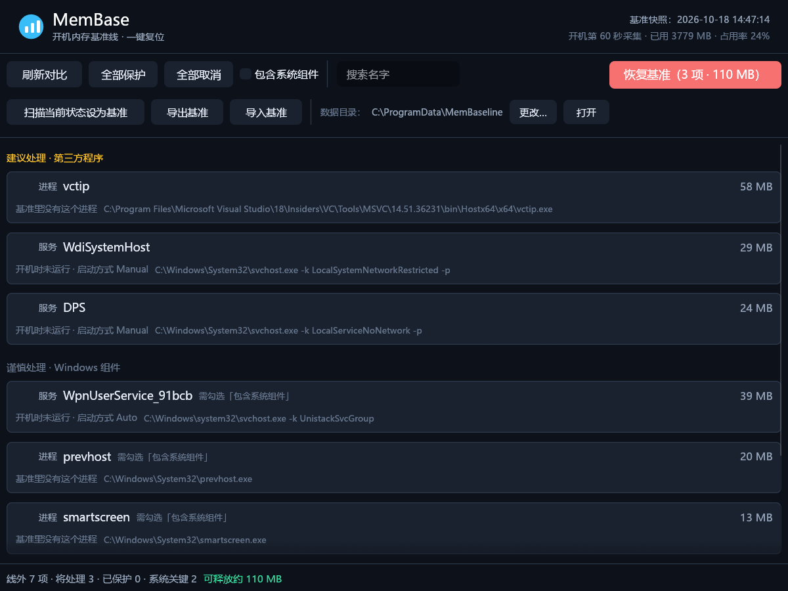

# MemBase

**开机内存基准线工具：采集一次「干净启动」的内存快照，之后随时对比、并一键关掉基准之外的东西。**

Boot-time memory baseline for Windows: snapshot once at boot, diff against it any time, and trim whatever wasn't there.



---

## 它解决什么问题

排查「开机越来越慢 / 内存莫名被吃」时，最难的是**没有一个可信的参照物**：

- 任务管理器只能看当下，看不到「刚开机时是什么样」
- 想复现冷启动就得重启，一天重启八次也不现实
- 网上说的「占内存大户」跟你机器上真实情况往往不是一回事

MemBase 的做法是把「开机第 60 秒」那一刻的进程与服务完整记录成**基准线**，之后任何时候拍一张实时快照做 diff —— 不再需要重启，也不会被「我刚开了一堆东西」干扰判断。

## 三个核心概念

| 概念 | 说明 |
|---|---|
| **基准线（baseline）** | 一份快照目录：`system.json` + 进程表 + 服务表 + 可读报告 |
| **线外清单（plan）** | 相对基准线多出来的进程/服务，分三档：建议 / 谨慎 / 禁止 |
| **恢复基准（trim）** | 关掉线外项。**默认 dry-run**，必须显式 `--execute` 才动手 |

## 快速开始（Windows）

```powershell
# 1) 装一次开机采集任务（SYSTEM 权限、无窗口），采集完自动销毁任务和 exe
membase install --at 60

# 2) 之后不用重启也能对比
membase compare                 # 与基准线做 diff
membase list                    # 列出线外项（只读）
membase trim --execute --yes    # 关掉线外项，回到基线状态

# 3) 不想等到下次开机？直接拿当前状态当基准
membase baseline capture
```

图形界面：`membase-ui`（桌面版 `MemBase.exe`）。勾选框 = **保护**（永不处理），红底按钮 = 恢复基准，第二行是基准线本身的维护（设为基准 / 导出 / 导入 / 数据目录）。

## 命令行（每个原子操作一个动词）

| 命令 | 作用 |
|---|---|
| `status` | 基准线信息 + 当前内存 + 线外计数 |
| `list` | 列出线外进程/服务（`--all` 含关键项） |
| `plan` | 只生成计划，可 `--to` 写 CSV |
| `trim` | 恢复基准：`--execute` 才动手，`--max` 限制数量 |
| `kill <名\|PID>` | 原子操作：终止指定进程 |
| `svc stop\|start <服务>` | 原子操作：启停单个服务 |
| `protect list\|add\|remove\|clear` | 保护名单，支持 `MuMu*` 通配 |
| `collect` | 采集快照（`--at` 指定开机后第几秒） |
| `compare` | 与最近一次基准 diff |
| `baseline info\|verify\|capture\|export\|import` | 基准线本体：查看 / 校验 / 采集当前态 / 打包 / 还原 |
| `config get\|set\|clear` | 数据目录（存哪儿由你决定） |
| `commands` | 自描述：所有命令 + 参数 + 平台 + 退出码表 |
| `install` / `uninstall` | 开机计划任务 |

所有命令都支持 `--json`，输出是**纯 ASCII 转义**的 JSON（中文走 `\uXXXX`），任何码页下都不会解析失败。适合脚本与 AI 调用：

```powershell
membase list --json | ConvertFrom-Json
membase trim --execute --yes --max 5 --json
```

退出码固定：`0` 成功 / `1` 参数 / `2` 无基准 / `3` IO / `4` 动作失败 / `5` 被护栏拒绝。

## 数据目录

优先级从高到低：

```
--out DIR  >  MEMBASE_ROOT  >  %APPDATA%\MemBase\config.json  >  %ProgramData%\MemBaseline
```

GUI 里第二行直接显示当前目录，`[更改…]` 可换到任意位置；CLI 用 `membase config set D:\我的基准`。配置文件放 APPDATA 而不是数据目录里 —— 数据目录本身可能被改，配置得先找得到。

## 安全模型

这是个会终止进程的工具，所以护栏比功能更重要：

1. **三档分级** —— 建议（第三方程序）/ 谨慎（Windows 组件，需显式勾选）/ 禁止（csrss、lsass、svchost、dwm、MsMpEng 等，永不触碰）
2. **自身保护** —— 不杀自己、启动自己的进程树，以及所有 `membase` 实例
3. **执行前二次校验** —— 即使计划文件被改写，关键组件依然拒绝执行
4. **默认 dry-run** —— 不加 `--execute` 只出计划；非交互环境必须显式 `--yes`；超过 `--max`（默认 20）直接拒绝
5. **服务不级联** —— 只用 `Stop-Service`（无 `-Force`），有依赖在跑就报错跳过

> 杀进程只做「对照实验」用。真正省内存的做法是排查出元凶后卸载它、或禁掉它的自启项；被系统判定为必需的东西杀了也会自己回来。

## 架构

按「纯逻辑 / 平台 / 前端」分层，前端共用同一套判定：

```
rust/membase/ （本仓库根）
├── crates/core/   membase-core   分级、CSV、diff、线外计划、基准线打包、配置
│                                 零平台依赖、零 unsafe、可在 Linux/容器里跑测试
├── crates/win/    membase-win    Win32 FFI：进程 / 服务 / 计划任务
│                                 整个工程唯一允许 unsafe 的地方
├── apps/cli/      membase-cli    → membase.exe
└── apps/gui/      membase-gui    → membase-ui.exe（egui）
```

`unsafe_code` 在 workspace 级别 `forbid`，只有 `membase-win` 单独放开。GUI 与 CLI 都调用 `core::build_plan()`，判定规则只有一份。

## 构建与测试

```powershell
# Windows：完整构建（含 GUI）
cargo build --workspace --release

# 只构建命令行
cargo build -p membase-cli --release

# 单元测试（纯逻辑，任何平台都能跑）
cargo test -p membase-core
```

Linux / 容器里验证（不需要 Windows）：

```bash
cargo test -p membase-core        # 30 个测试：分级、CSV、diff、计划、打包、配置
cargo build -p membase-cli        # 平台层在非 Windows 上是空 crate，CLI 仍可编译
```

## 已知限制

- **只按进程名判定**：同一个程序多开的实例不视为「线外」，也不会被清理
- 部分字段在 Rust 版为空：`UserName`、`CommandLine`、`VirtualMB`、`CpuSeconds`（需要读目标进程 PEB / 令牌；PowerShell 版有）
- `OsCaption` / 页面文件峰值暂未填充
- 基准线包是 **store 方式的 zip**（无压缩），只保证与自身互操作
- GUI 仅 Windows；CLI 的采集/清理能力也仅 Windows（`baseline` / `config` / `commands` 跨平台）

## License

MIT
