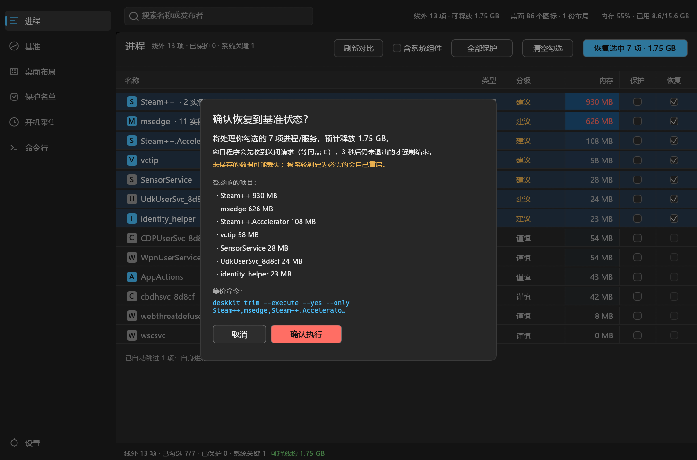
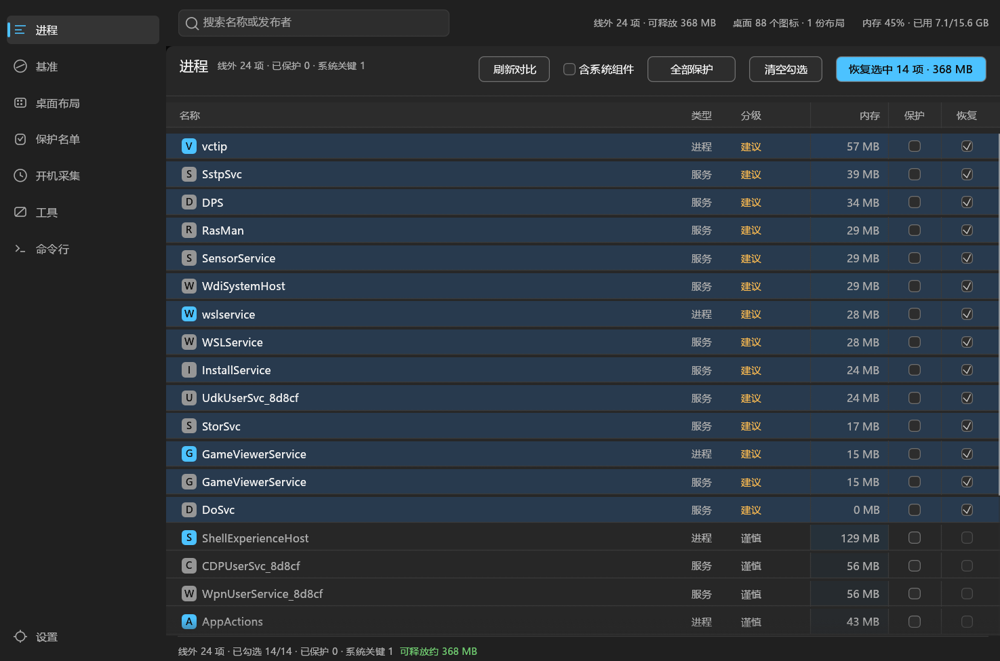
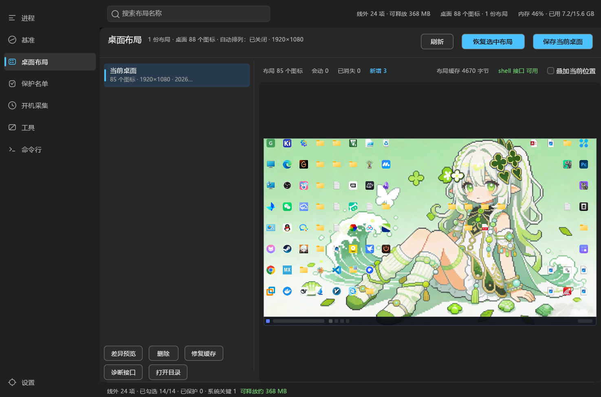

# DeskKit

**两件桌面杂事，一个纯 Rust 程序：开机内存基准线 + 桌面图标布局。**

开机久了内存被谁吃了？桌面图标被谁弄乱了？DeskKit 把这两个问题放进同一个窗口：
左边导航切页，右边该干嘛干嘛。界面用的是 MemBase 那套（左侧导航 / 顶栏搜索 / 状态栏 / 浅深两色），
桌面布局页的预览是**你桌面的真实样子**——真壁纸、真图标、真任务栏。

**硬约束：人能点的，脚本一定能发。** 界面上的每个按钮，鼠标停上去都会写出它的等价命令，
程序里还有一页「命令行」把 30 个动作和命令一一列出来。


---

## 它是怎么来的

| 来源 | 带来了什么 | 现在的形态 |
|---|---|---|
| **MemBase** | 界面骨架（egui 五页导航、调色板、表格、状态栏）、开机基准线 / 线外清单 / 先礼后兵地恢复 | `crates/core` + `crates/win` + `apps/gui`，界面**原样**作为底座 |
| **DeskPos**（Rust / C# / Python 三端） | 桌面图标快照、差异预览、恢复、修复系统布局缓存 | 并进同一套 crate，成为「桌面布局」页与 `layout` 命令组 |
| **DeskPos.exe**（.NET 单文件） | 那个 53 MB 的自包含 exe | 不需要了：这里是**纯 Rust**，无 .NET、无 Python、无运行时依赖 |

融合时没有另起一套数据：**布局文件、配置、基准线全在原位**，老用户打开就能看到以前存的布局。

| 数据 | 位置 |
|---|---|
| 桌面布局 | `%APPDATA%\DesktopIconPos\layouts\*.json`（与 DeskPos 三端共用同一份） |
| 主题 / 数据目录配置 | `%APPDATA%\MemBase\theme.txt`、`%APPDATA%\MemBase\config.json` |
| 内存基准线 | `C:\ProgramData\MemBaseline\run_*\T+60s\` |

## 界面

左侧导航八页：

```
进程        线外清单表格（名称 / 类型 / 分级 / 内存 / 保护 / 恢复），内存列按用量热力着色
基准        基准快照时间 · 采集于开机第 N 秒 · 已用内存 · 导出 / 导入 .mbz
桌面布局    布局清单 + 真实缩略预览 + 差异条 + 叠加当前位置 + 保存 / 恢复 / 删除 / 修复缓存
保护名单    protect.txt 的全部规则，可单条移除或整份清空
开机采集    开机第 N 秒采集，SYSTEM 权限、无窗口，采完自动销毁任务
工具        息屏（全屏黑 + 可选热键退出 + 时/分/秒）+ 显示器与路径信息
命令行      30 个界面动作 → 等价命令，逐条可复制
设置        数据目录 · 布局目录 · 运行身份 · 外观（浅色 / 深色）
```

### 桌面布局页

- **真实预览**：拿当前壁纸当底、逐个图标取系统真实图标（48px 超大清准），按保存时的坐标摆好，连任务栏都画上
- **悬停看名字**：图标缩小后认不出，鼠标停上去弹名称
- **叠加当前位置**：蓝色虚线标出「这次恢复会移动的那几个图标现在在哪」
- **差异条**：`会动 N · 已消失 N · 新增 N · shell 接口 可用/不可用 · 布局缓存 N 字节`
- **保存**：同名覆盖；名字里的 `/ : * ?` 会换成下划线
- **恢复**：优先走 shell 官方接口（能持久化），不可用时退回改 explorer 内存，并如实告诉你「重启可能被覆盖」
- **修复缓存**：只在「每次重启固定错乱同一批图标」时才需要，先备份注册表值再删除


### 工具页 · 息屏

**只黑屏，不锁屏**。点一下，整屏纯黑，按 **ESC** 就回来（默认不动显示器电源）：

| 做什么 | 怎么做 |
|---|---|
| 进入息屏 | 点「息屏」（命令行 `deskkit screen off`） |
| 退出热键 | 下拉框选 **ESC / 空格 / 回车 / 任意键**，默认 ESC；点一下鼠标、动一下鼠标也退 |
| 息屏时长 | **时 / 分 / 秒** 三个框分开调，精确到秒；全 0 = 不定时，一直黑到你按键 |
| 快捷时长 | 5 分钟 / 30 分钟 / 1 小时 三个按钮一键设 |
| 到点之后 | 自动退出息屏、还原窗口 |
| 同时关闭显示器 | 可选开关，**默认关**；命令行 `deskkit screen power on` |
| 上次息屏 | 工具页直接看，记录在 `%APPDATA%\MemBase\last_screen_off.txt` |

- 默认只盖一层**全屏纯黑窗口**，显示器始终亮着：这是唯一保证「一定退得出来」的做法，也是同类工具（如息屏助手）的默认行为
- 「同时关闭显示器」会真发 `WM_SYSCOMMAND / SC_MONITORPOWER`：更省电，但**有些机器关得掉、叫不醒**——关掉后屏幕黑着、按什么都没反应。所以它默认关闭，勾之前请先确认你这台机器能正常唤醒
- 退出走**系统级监听**：后台线程常挂 `WH_KEYBOARD_LL` 低级键盘钩子（另加按键/光标轮询兜底），跟窗口有没有焦点、窗口是否被隐藏都无关；命中就吞掉那一下并立刻唤醒界面
- 退出判断挂在 `eframe::App::logic` 而不是画界面的那一路——窗口被最小化 / 隐藏时 eframe 只调 `logic`，写在 `ui` 里就永远不会被执行
- 前 3 秒会在屏幕中央显示一行很暗的「按 ESC 退出 · 0:29:59 后自动亮」，之后彻底全黑（提示里的键名跟着你设的热键走）
- 从点下「息屏」到松手后 0.8 秒内，鼠标的挪动不算退出（免得手还没离开鼠标就自己退了）


黑屏层长这样（前 3 秒有一行很暗的提示，之后彻底全黑）：


## 命令行

一个 exe 两种身份：双击开界面，带参数就是命令行（`deskkit-ui.exe layout list` 也能用）。
另外有独立控制台版 `deskkit.exe`，给计划任务和脚本用。

```bash
deskkit status                        # 基准线 + 当前内存 + 线外计数
deskkit list                          # 线外清单（只读）
deskkit trim --execute --yes          # 恢复基准：先礼后兵地关掉线外项
deskkit baseline capture              # 把当前状态立成基准
deskkit install --at 60               # 安排下次开机第 60 秒采集

deskkit layout list                   # 已保存的布局
deskkit layout save 工作              # 保存当前桌面
deskkit layout diff 工作 --positions  # 只看差异，逐个打印当前坐标
deskkit layout restore 工作 --execute --yes
deskkit layout status                 # 图标数 / 自动排列 / 分辨率 / shell 接口 / 缓存
deskkit layout probe                  # shell 官方接口能不能用
deskkit layout repair --execute --yes # 备份并清理系统布局缓存
deskkit theme set dark
deskkit ui --page layouts              # 打开界面并停在布局页

deskkit screen off                              # 息屏（默认只盖全屏黑窗，不动显示器电源）
deskkit screen off --seconds 90 --exit-key space # 这次 90 秒、空格退出
deskkit screen off --seconds 0                  # 不定时，一直黑到你按
deskkit screen off --delay 5                    # 5 秒后再关，够你把手拿开
deskkit screen duration 0:05:30                 # 默认时长 5 分 30 秒（也认 90s / 5m / 1h）
deskkit screen key space                        # 默认退出热键（跟界面下拉框同一个文件）
deskkit screen power on                         # 息屏时同时关显示器电源（更省电，但可能叫不醒）
deskkit screen status                           # 显示器 / 通道 / 时长 / 热键 / 上次息屏
```

每个命令都支持 `--json`，`deskkit commands --json` 还会把整张「界面动作 → 命令」表一起导出：

```json
{"version":"1.0.0", "commands":[...],
 "gui_actions":[{"key":"layout_restore","page":"桌面布局","label":"恢复选中布局",
                 "cli":"deskkit layout restore <名字> --execute --yes", "note":"..."}]}
```

退出码：`0` 成功 / `1` 参数 / `2` 没有基准或布局 / `3` 读写 / `4` 动作失败 / `5` 被拒绝。

**默认不动手**：`trim`、`layout restore`、`layout repair`、`layout delete` 不加 `--execute` / `--yes` 就只报计划。
这样界面上的「确认」和命令行里的「显式开关」是同一件事——而且确认弹窗里直接写着这次勾选对应的命令：




## 构建

需要 Windows 10/11 + Rust 1.75 以上。

```bash
cargo build --workspace --release
#   target\release\deskkit-ui.exe   界面（带参数即命令行）
#   target\release\deskkit.exe      控制台版
```

或者双击 `build.bat`，产物收进 `dist\`。

```bash
cargo test -p deskkit-core    # 42 个纯逻辑测试，不需要桌面环境
python tools/verify.py        # 91 项端到端验收（见下）
```

## 验收

「编译过了」不算完。`tools/verify.py` 会把每个动词、每一页都真跑一遍：

- **产物 3 项 + 命令行 68 项**：每个子命令发一次（写盘的一律指向临时目录），危险动作只验护栏——
  `trim --execute` 无 `--yes` 必须被拒、`layout repair` 不加 `--execute` 不许动注册表、
  `screen off --dry-run` 只探通道、不关屏、不改「上次息屏」记录；时长与热键改完必须读回并还原
- **界面 11 项**：八页各截一帧并比对 md5（确认 `DESKKIT_PAGE` 真的切页，不是八张同一页）、两个确认弹窗；
  另有一项息屏黑屏层（断言 ≥95% 像素纯黑且仍有提示文字）
- **一致性 5 项**：30 个界面动作 → 命令的动词都真实存在；GUI 源码里引用的每个 key 都在表里；
  反向检查有没有「界面上有按钮、表里没命令」的动作
- **环境复原 4 项**：保护名单条数、主题、数据目录、计划任务全部回到验收前的状态

最新结果见 [docs/verify-1.0.0.md](docs/verify-1.0.0.md)：**91 项，通过 91，失败 0**。

八页实拍（同一台机器连续截的，可对比深浅色与各页数据）：

| 进程 | 桌面布局 | 工具 |
|---|---|---|
|  |  |  |


## 结构

```
crates/core   纯逻辑：分级 / CSV / diff / 线外计划 / 基准线打包 + 布局模型与存储（零平台依赖，零 unsafe）
crates/win    平台层：Win32 进程 / 服务 / 计划任务 + 桌面 ListView / shell IFolderView（unsafe 只在这里）
apps/cli      命令行：每个原子操作一个动词，ACTIONS 表是「界面动作 → 命令」的单一来源
apps/gui      egui 界面：MemBase 骨架 + 桌面布局页 + 命令行页
```

## 实现要点

- 恢复位置首选 shell 自己的 `IFolderView::SelectAndPositionItems`（`IShellWindows → IServiceProvider → IShellBrowser → IFolderView`），
  位置由 shell 写入并立即持久化；拿不到才退回 `LVM_SETITEMPOSITION32` + 跨进程写内存
- 必须 `SetProcessDpiAwarenessContext(-4)` + `CoInitialize`：否则 125% / 150% 缩放下读到的是逻辑像素，恢复后整体偏移
  （`deskkit layout` 和 GUI 走同一个 `deskkit_win::init()`，命令行不会漏）
- 只清 `LVS_AUTOARRANGE`，不发 `LVM_ARRANGE`：后者会立刻重排，把刚写好的位置冲掉
- shell 的网格吸附是异步的，写完读回核对，最多 4 轮，一次点击收敛
- 内存侧仍然是「先礼后兵」：有窗口的先发 `WM_CLOSE`，宽限期后才强制结束；一次操作共用一个宽限期
- `schtasks` 自己的「成功: 已创建计划任务」会被静音：混进 stdout 会把 `--json` 打脏（验收时真踩到了）
- 两套 Win32 绑定（`win.rs` 进程侧 / `sys.rs` 桌面侧）各自独立：句柄类型写法不同（`*mut c_void` vs `isize`），
  ABI 一致，刻意不合并以免为统一类型改几十处调用点

## 已知限制

- 图标按**显示名**匹配：改名或删掉的文件不会被恢复，新加的图标保持原位
- 要跨进程读写 explorer 内存，**杀软报毒是常态**，加白名单即可
- shell 接口不可用时恢复只改内存，重启可能被系统覆盖（界面和 `layout status` 都会明说）
- 布局是在别的分辨率 / 缩放下保存的，坐标可能不落在当前网格点，会被吸附
- 预览背景是静态壁纸；动态壁纸取到的是当前帧

## License

[MIT](LICENSE)
